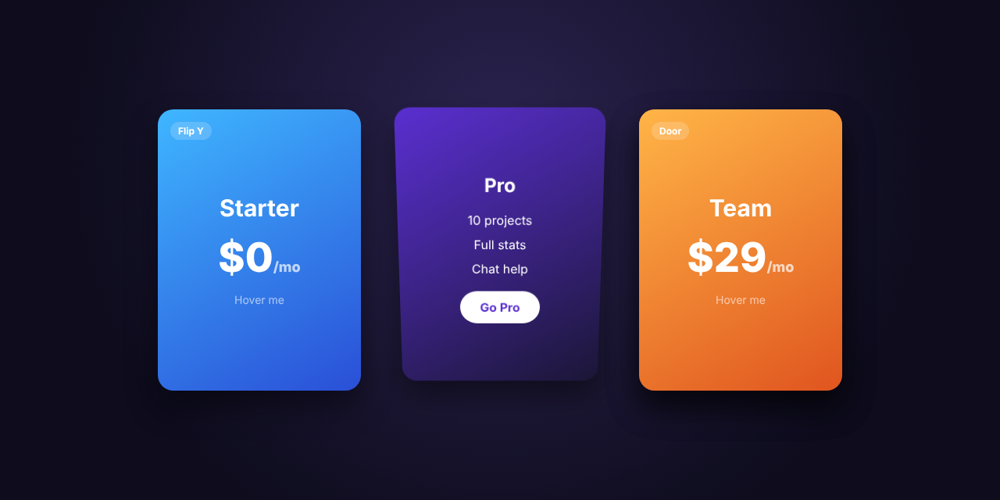

# 3D Flip Cards



Three pricing cards, each with a different 3D hover effect. Pure HTML and CSS, zero JavaScript.

| Card | Effect |
|---|---|
| Starter | **Flip Y:** turns left to right around the vertical axis |
| Pro | **Flip X:** turns top to bottom around the horizontal axis |
| Team | **Door:** the front swings open on a hinge to show the back |

## How it works

- `perspective` on the card gives the 3D depth (smaller = stronger effect).
- `.inner` holds both faces with `transform-style: preserve-3d`, so they stay in 3D space.
- Both faces sit on top of each other with `backface-visibility: hidden`. The back starts rotated 180°, so turning `.inner` 180° swaps which side faces you.
- The door card skips the flip: the back stays still, and the front rotates around its left edge (`transform-origin: left center`).

## Touch and keyboard

Each card has `tabindex="0"` and the effects also trigger on `:focus-within`, so you can tab to a card, or tap it on a phone, to flip it.

## Customize

- Colours: each card sets `--c1` and `--c2` in `style.css`.
- Speed: change the `0.8s` in the `transition` lines.
- Depth: change `perspective: 1000px` on `.card`.

## Run

Open `index.html` in a browser. No build step or dependencies.

## Files

```
3D-Flip-Cards/
├── index.html
├── style.css
└── preview.png
```
