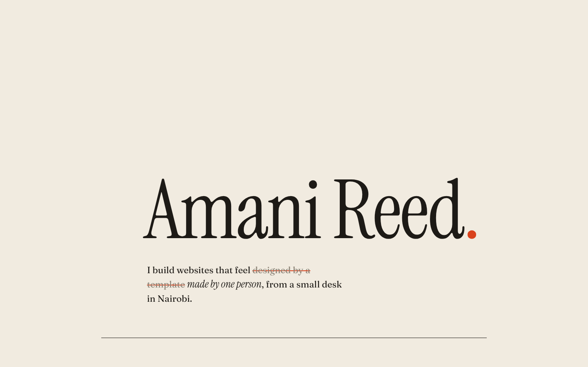

# Animated Portfolio



A one-page portfolio that doesn't look like a template. Warm paper, ink and a single vermilion accent. Plain HTML, CSS and JavaScript, no framework.

## What's in it

- **A hand-set masthead.** The name drops in letter by letter, each one slightly crooked, then a red full stop stamps down.
- **A correction.** The intro crosses out a phrase and writes the real one in.
- **Margin numbers.** Section numbers sit beside the headings, like notes in a printed book.
- **Work rows with a moving preview.** A card follows your cursor with a little lag and leans into its own speed. Hover a row and the rest fade back.
- **A hand-drawn underline** that draws itself as you scroll to it.
- **A margin note** and a live Nairobi clock in the footer.

Everything respects `prefers-reduced-motion`, and the preview card is hidden on touch screens.

## Make it yours

- Your name: the `<h1>` in `index.html`.
- Your projects: the `<li class="row">` items. Each has a `data-art` letter (a to e) that picks the preview artwork in `style.css`.
- Colours: three variables at the top of `style.css`: `--paper`, `--ink`, `--red`.
- Time zone: the `timeZone` option at the bottom of `script.js`.

## Run

Open `index.html` in a browser. No build step.

## Files

```
Animated-Portfolio/
├── index.html
├── style.css
├── script.js
├── fonts/      Instrument Serif, Fraunces, JetBrains Mono (SIL Open Font License)
└── preview.png
```
