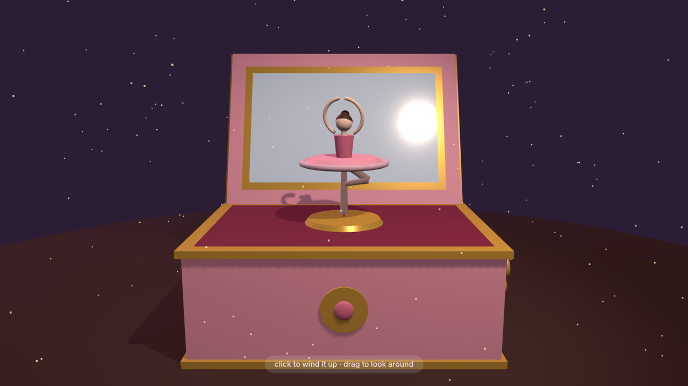

# Ballerina Music Box



A wind-up music box in three.js. Click it and the lid swings open, a ballerina rises out of the velvet and turns to a little tune. As the spring runs down the tune slows, she stops, sinks back and the lid closes. Everything is made from three.js primitives, and the music is synthesised in the browser with the Web Audio API. No models, no textures, no audio files.

## How it's built

- **One helper.** `part(geometry, material, x, y, z, parent)` makes a mesh, places it, turns on shadows and adds it to the scene or a group.
- **The box.** A pink box, gold trim from two slightly bigger flat boxes, a velvet plane on top and a badge on the front.
- **The lid** sits in a group whose origin is the hinge at the back, so rotating the group swings it open. The mirror is a bright plane with a little emissive glow. A real metallic material needs an environment to reflect and would render black.
- **The ballerina.** Cylinders and spheres. One leg is en pointe, the other bent in passé. The tutu is two cylinders and a torus frill. The arms are two partial tori (the last `TorusGeometry` argument is the arc) forming fifth position above her head.
- **The spring.** One `speed` value set to 1 when you click and drained a little every frame. It drives the spin, the winding key, the lid, the rise and the tempo of the tune.
- **The tune.** Each note is two sine oscillators, the fundamental plus a quiet inharmonic partial, with a fast exponential fade. That decay is what makes it sound like a music box.
- **Click versus drag.** A click winds it and a drag orbits the camera. The two are told apart by how far the pointer moved.
- **Sparkles.** One `THREE.Points` cloud that fades in with the lid.
- **Phones.** On tall screens the camera steps back so the whole box fits.

## Controls

- **Click** to wind it up
- **Drag** to look around, **scroll** to zoom

## Run

three.js loads from a CDN through an import map, and browsers won't load ES modules from `file://`. Serve the folder with any static server, for example:

```
npx serve .
```

or the Live Server extension in VS Code. Browsers only allow sound after a click, which is exactly when the music starts.

## Files

```
Ballerina-Music-Box/
├── index.html   the import map
├── style.css
├── script.js    the scene, the spring and the synth
└── preview.png
```
