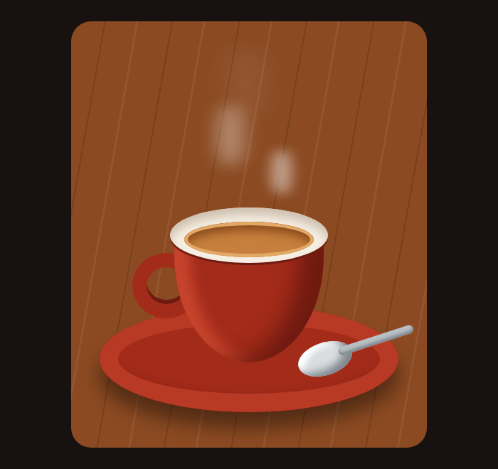

# CSS Coffee Cup



A cup of coffee on a saucer, with a spoon and rising steam, drawn with only HTML and CSS: 11 elements, no images, no SVG, no JavaScript.

## How each part is made

- **Saucer.** A wide box with `border-radius: 50%`. Inset shadows make the ring and the dip.
- **Cup.** A box with only its bottom corners rounded. Two inset shadows give it a light side and a dark side.
- **Rim and coffee.** Two ellipses, one inside the other.
- **Handle.** A box with a thick border and a 50% radius, placed before the cup in the HTML so it sits behind it.
- **Spoon.** An ellipse for the bowl and a thin rounded bar for the handle, rotated together.
- **Table.** One `repeating-linear-gradient` for the wood grain.
- **Steam.** Three blurred white ellipses. One keyframe animation lifts, widens and fades each one, and a negative `animation-delay` staggers them.

## Change it

The colours are variables at the top of `style.css`: `--wood`, `--red`, `--dark`, `--cream` and `--coffee`. Change `--red` for a different cup, or the duration in `animation: rise 4s` for lazier or livelier steam.

## Run

Open `index.html` in a browser. No build step, no JavaScript.

## Files

```
CSS-Coffee-Cup/
├── index.html
├── style.css
└── preview.png
```
