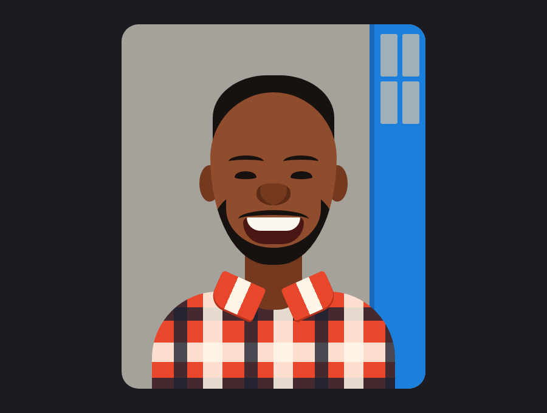

# CSS Face Portrait



A portrait drawn with nothing but HTML and CSS: 19 divs, no images, no SVG, no canvas. It blinks, and it raises its eyebrows and smiles wider when you hover.

## How each part is made

- **Head.** One box. Eight values in `border-radius` give it a wide forehead and a narrow chin.
- **Hair.** A dark box behind the head, so only the top and sides show.
- **Eyebrows and moustache.** A box with only a top border and a 50% radius becomes a curved line.
- **Smile.** A dark box with rounded bottom corners. The teeth are a white box inside it, clipped by `overflow: hidden`.
- **Beard.** A dark circle with a skin-coloured chin on top of it, clipped by the head.
- **Shirt.** Two `repeating-linear-gradient`s crossed at 90° make the plaid.
- **Collar.** Two rotated boxes.
- **Door.** A blue strip with a small grid of window panes.

## Change it

The colours are variables at the top of `style.css`: `--skin`, `--shade`, `--hair`, `--wall` and `--blue`. Every part is positioned in pixels inside a 500 × 600 card, so you can nudge any feature by changing its `left` and `top`.

## Run

Open `index.html` in a browser. No build step, no JavaScript.

## Files

```
CSS-Face-Portrait/
├── index.html
├── style.css
└── preview.png
```
