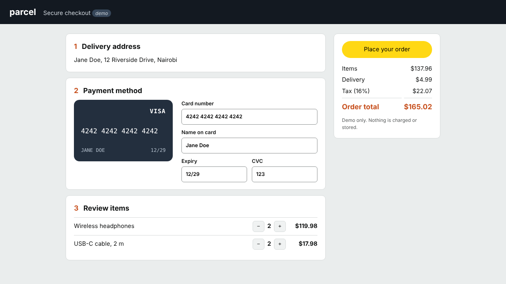

# Checkout Flow



A single-page card checkout in plain HTML, CSS and JavaScript: numbered steps, a live card preview, formatted inputs, real validation and an order summary that always adds up. No framework, no libraries.

This is a front-end demo for a made-up shop. It never sends, stores or logs anything you type.

## What it does

- **Formats as you type.** Card number in groups of four, expiry as `MM/YY`, digits only in the CVC.
- **Live card preview.** The number, name and expiry appear on the card, and the brand (Visa, Mastercard, Amex) is detected from the first digits.
- **Real validation.** The Luhn checksum rejects typos and made-up card numbers, the expiry must be in the future, and the order button stays locked until every field passes.
- **Exact totals.** Prices are whole cents (integers), so there are no floating-point surprises. Tax is rounded once, and formatting happens only at display time.
- **Quantity buttons** handled by one delegated click listener.
- **Accessible, autofill-friendly fields.** Real `<label>`s, `aria-invalid` on bad fields, `autocomplete="cc-number"` and friends, and `inputmode="numeric"` for the right mobile keyboard.

## Try it

- `4242 4242 4242 4242` is a valid Visa test number. `5105 1051 0510 5100` is a Mastercard one.
- `1234 5678 1234 5678` fails the Luhn check.

## If you build a real one

A real checkout should not let card numbers touch your own code or server at all. Use your payment provider's hosted fields (Stripe Elements, Adyen Drop-in, Braintree Hosted Fields and similar): the inputs live in the provider's iframe, your page only receives a token, and most of the PCI DSS burden stays with them. Validate again on the server, and compute totals there too. Never trust prices sent from the browser.

## Run

Open `index.html` in a browser. No build step or dependencies.

## Files

```
Checkout-Flow/
├── index.html
├── style.css
├── script.js
└── preview.png
```
