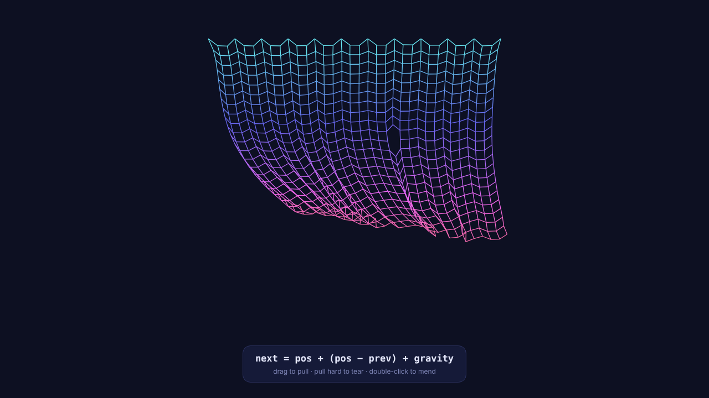

# Cloth Physics



A cloth you can drag, tear and mend, built on one line of maths. Plain JavaScript and Canvas, no libraries.

```
next = pos + (pos − prev) + gravity
```

That is Verlet integration: every point keeps moving the way it was already moving, plus gravity. There is no velocity variable anywhere; the speed is just the gap between where a point is and where it was.

## How it works

1. **Points.** A 34 × 22 grid. Each point remembers its current and previous position.
2. **The equation.** Each frame, every point moves by `(pos − prev)` plus gravity, with a little drag and wind.
3. **Sticks.** Every point is tied to its right and lower neighbour. After moving, each stick pulls its two ends back to the right distance. Doing that pass 5 times a frame makes the cloth firm.
4. **Pins.** Every third point in the top row never moves, which gives the curtain shape.
5. **Tearing.** A stick stretched past 3.4× its length is removed.

## Controls

- **Drag** to pull the cloth
- **Pull hard** to tear it
- **Double-click** to mend it

## Change it

All the feel lives in the constants at the top of `script.js`: `COLS`, `ROWS`, `GAP`, `GRAVITY`, `DRAG` and `TEAR`.

## Run

Open `index.html` in a browser. No build step or dependencies.

## Files

```
Cloth-Physics/
├── index.html
├── style.css
├── script.js
└── preview.png
```
