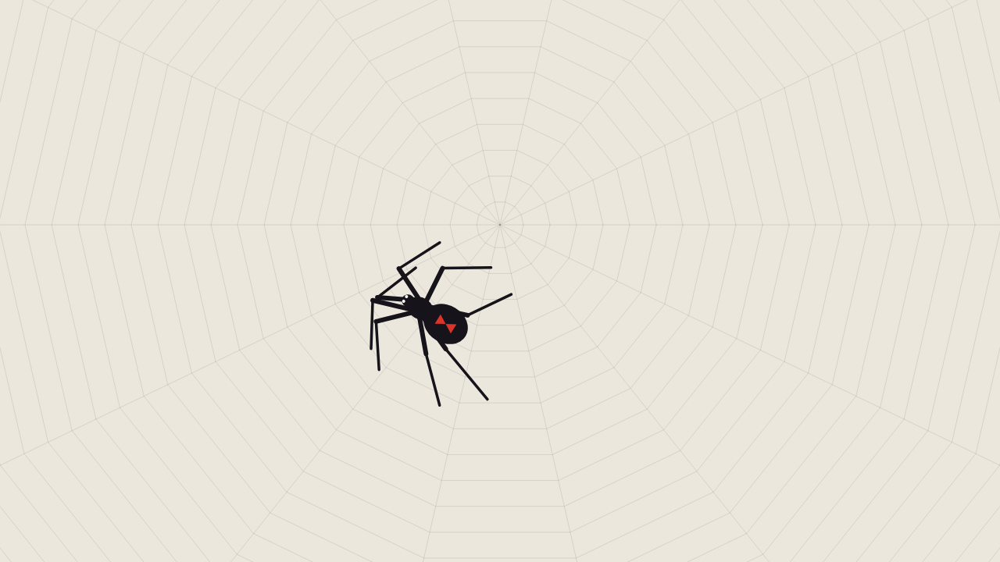

# Cursor Spider



A black widow that follows your cursor across a web, walking on eight legs that each step on their own. Plain JavaScript and Canvas, no libraries.

## How it works

1. **The body chases the cursor.** It moves a fraction of the distance each frame, up to a top speed, and turns gradually towards where it's heading.
2. **Each leg has a rest spot** measured from the body (forward, and out to the side).
3. **Feet stay planted.** A foot only moves when its rest spot gets more than 40px away. Then it steps there, plus a little extra in the direction of travel, with an eased 0–1 animation.
4. **Alternating gait.** Legs are in two groups, and a leg can't start a step while the other group is mid-step, so the spider always has feet on the ground. A foot dragged too far steps anyway.
5. **Two-bone IK draws each leg.** Given the hip, the foot and two segment lengths, the law of cosines gives the knee. There are two possible knees, and each leg keeps the one that bends its own way: front legs forward, back legs backward.

## Change it

The top of `script.js` holds the feel: the leg lengths `UPPER` and `LOWER`, the rest spots in `REST`, the step distance (`gap > 40`) and the body speed in `moveBody`.

## Run

Open `index.html` in a browser. Works with touch too.

## Files

```
Cursor-Spider/
├── index.html
├── style.css
├── script.js
└── preview.png
```
