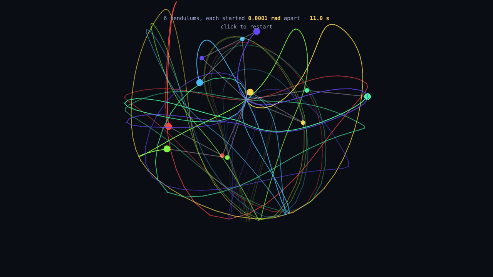

# Double Pendulum Chaos



Six double pendulums that start 0.0001 radians apart. For a few seconds they move as one. Then they split into six completely different paths. Plain JavaScript and Canvas, no libraries.

## How it works

- **State.** Each pendulum is just two angles (`a1`, `a2`) and two angular speeds (`w1`, `w2`).
- **The equations of motion.** `accel()` is the standard double-pendulum formula (from the Lagrangian) for the two angular accelerations, with lengths, masses and gravity as constants.
- **Integration.** Each frame is split into 20 small steps of semi-implicit Euler: update the speeds from the accelerations, then the angles from the speeds. Small steps keep it stable.
- **Real time.** The step size comes from the frame's timestamp, so it runs at the same speed at 30, 60 or 120 fps.
- **Trails.** Each pendulum keeps the last 180 positions of its lower bob, drawn as segments that fade from transparent to solid.
- **Chaos.** The only difference between the six is `i * NUDGE` in the starting angle. That gap roughly doubles every fraction of a second, which is what "sensitive dependence on initial conditions" means.

Click anywhere to restart from a new random angle.

## Change it

Try `NUDGE = 0.000001` (it takes longer to split), more pendulums with `N`, or different masses and lengths.

## Run

Open `index.html` in a browser. No build step.

## Files

```
Double-Pendulum-Chaos/
├── index.html
├── style.css
├── script.js
└── preview.png
```
