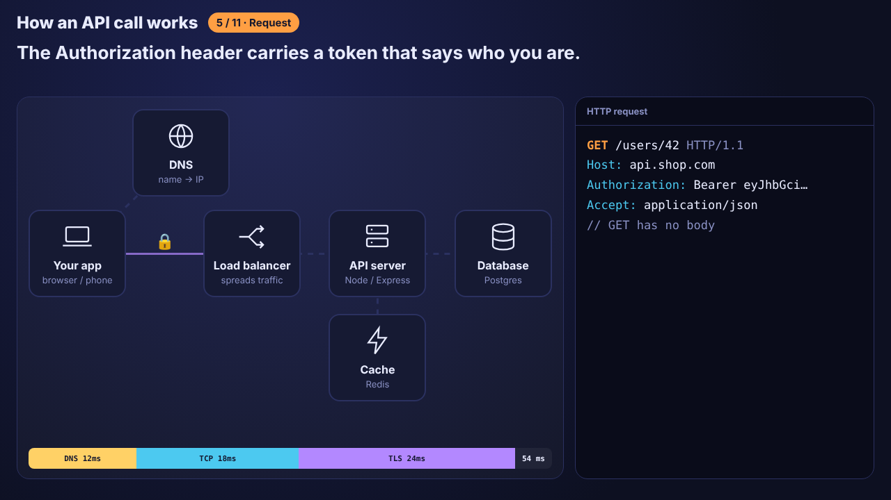

# How an API Call Works



An animated, step-by-step explainer of what happens when your code calls an API, from typing the URL to seeing the data on screen. Plain HTML, CSS and JavaScript.

## The steps

1. **DNS:** turns `api.shop.com` into an IP address.
2. **TCP:** a three-way handshake opens a connection.
3. **TLS:** encrypts it (the S in HTTPS).
4. **Request:** method, path and headers, including your token.
5. **Middleware:** rate limit, auth and validation before your code runs.
6. **Data:** check the cache, then the database, with a safe parameterized query.
7. **Response:** status code, headers and a JSON body.

It ends with a status code cheat sheet and a recap. A timing bar adds up the milliseconds of each step.

## Controls

- **Space:** play or pause
- **← / →** or the arrow buttons: previous or next step
- The dots jump to any step

Add `?short` to the URL for a quick version.

## Change it

Everything the animation shows lives in `steps.js`: the nodes, where they sit, and each step's captions, messages and inspector lines. Edit the text or times there, and `script.js` draws it.

## Run

Open `index.html` in a browser. No build step or dependencies.

## Files

```
How-APIs-Work/
├── index.html
├── style.css
├── steps.js    the script of the animation (data only)
├── script.js   draws any moment from the timeline
└── preview.png
```
