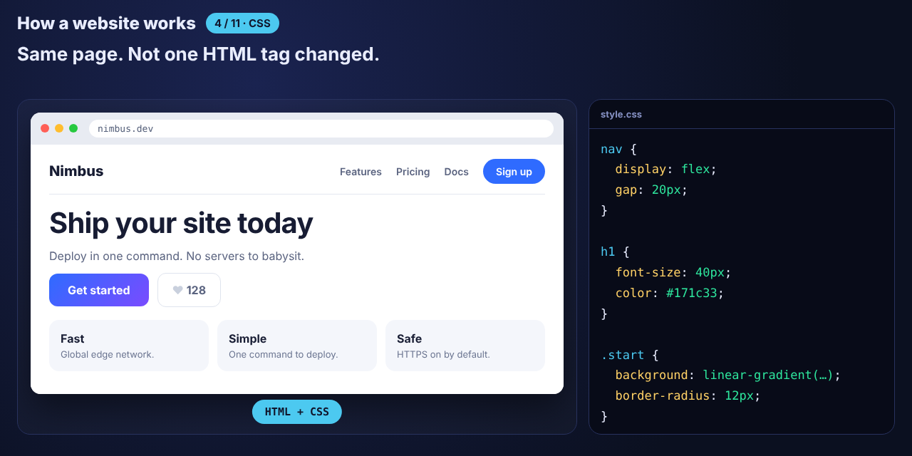

# How a Website Works



An animated, step-by-step explainer of what a website actually is, from the files sitting on a server to the pixels on your screen. Plain HTML, CSS and JavaScript.

## The steps

1. **The files.** A website is three files on a computer that never sleeps.
2. **The request.** Your browser asks for them and they arrive as plain text.
3. **HTML.** The structure, shown with no styling at all.
4. **CSS.** The same markup, now with a look. Not one tag changed.
5. **JavaScript.** The behaviour, demonstrated on a working button.
6. **The DOM.** Your HTML read into a tree.
7. **The render tree.** The DOM and the CSSOM merged into what's visible.
8. **Layout and paint.** Where every box goes, then the actual pixels.
9. **Front-end and back-end.** What runs on your device, and what doesn't.
10. **Static or dynamic.** The same files for everyone, or a page built per visitor.
11. **Recap.**

The page in steps 3 to 5 is real. The markup never changes between them, only the CSS, so the unstyled version is genuinely what the browser does on its own.

## Controls

- **Space:** play or pause
- **← / →** or the arrow buttons: previous or next step
- The dots jump to any step

Add `?short` to the URL for a quick version.

## Change it

The whole explainer lives in `steps.js`: the scenes, the captions, the messages that travel between boxes, and the inspector lines. `script.js` draws any moment from the current time, so seeking and replaying always give the same frame.

## Run

Open `index.html` in a browser. No build step or dependencies.

## Files

```
How-Websites-Work/
├── index.html
├── style.css
├── steps.js    the script of the animation (data only)
├── script.js   draws any moment from the timeline
└── preview.png
```
