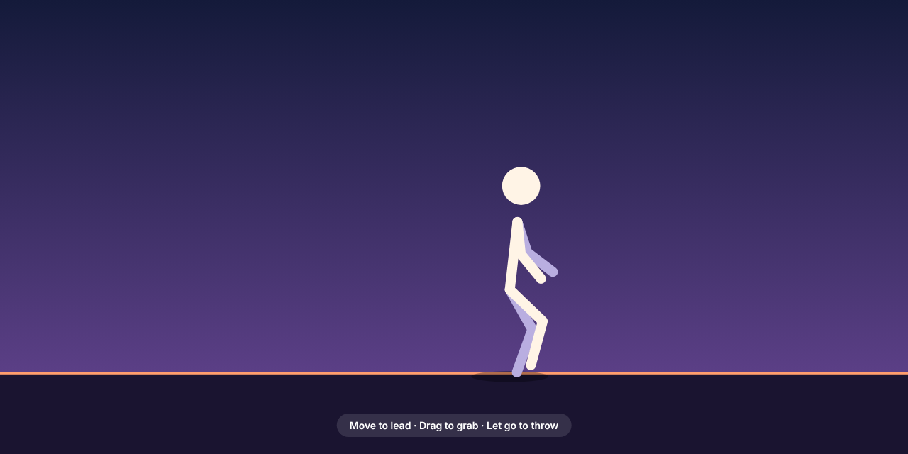

# Physics Ragdoll Walk



A stick figure ragdoll with real physics, drawn on a canvas in plain JavaScript. It balances, walks toward your pointer, and goes floppy when you grab it. Throw it across the screen and it gets back up on its own.

## Controls

- **Move** the mouse (or your finger) to lead it.
- **Drag** any joint to pick it up.
- **Let go** while moving to throw it.

If you stop moving the pointer, it wanders around by itself.

## How it works

- **Verlet physics:** every joint is a point that remembers its last position, so speed comes for free. Gravity pulls each point down, and sticks between points are pushed back to their length several times per frame.
- **Ragdoll:** 11 points (head, neck, hips, elbows, hands, knees, feet) joined by 10 sticks.
- **Brain:** while it's in control, it works out the pose it wants (upright body, feet on the ground, knees bent forward) and steers each joint toward it. Physics does the rest.
- **Walking:** when a foot falls too far behind the hips, it takes a step along an arc to a spot ahead of them. Arms swing with the opposite leg.
- **Falling and getting up:** grabbing it drops its `strength` to 0, so it's a pure ragdoll. After you let go it waits a moment, then slowly gets its strength back and stands up.

## Customize

Settings are at the top of `script.js`:

- `GRAVITY`: how heavy the world feels.
- `PASSES`: how stiff the sticks are (more = stiffer).
- `STEP_TIME`: how long one footstep takes.

## Run

Open `index.html` in a browser. No build step or dependencies.

## Files

```
Ragdoll-Walk/
├── index.html
├── style.css
├── script.js
└── preview.png
```
