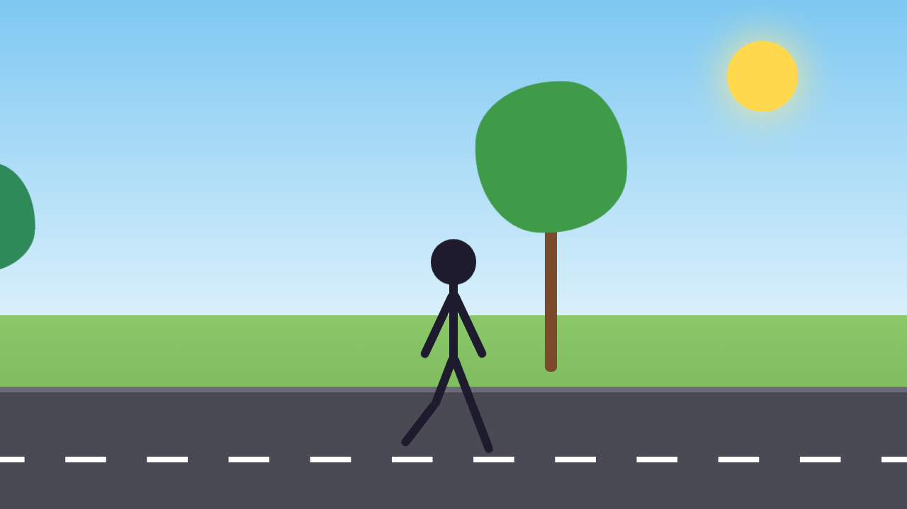

# CSS Stick Figure Walk



A stick figure walking down a road past two trees, built almost entirely with CSS. Every body part is a plain `div` used as a stick, and the whole walk cycle is CSS keyframes. JavaScript is only used for pausing.

## How it works

- **Person:** a circle for the head, one stick for the body, two for the arms, and two legs that each have a thigh and a shin, so the knee bends.
- **Walk cycle:** thighs and arms swing in opposite directions, the right side runs half a step behind the left, and the body dips when both feet are down.
- **Trees:** each tree is a vertical stick (the trunk) with a circle on top whose wobbly `border-radius` makes curvy sides. The crowns gently sway.
- **Movement:** the person stays in the middle while the road line and trees slide left at the same speed, so it looks like they're walking forward.

## Controls

Click, tap or press **Space** to pause and resume.

## Customize

Settings are at the top of `style.css`:

- `--step`: how long one full walk cycle takes. Smaller is faster.
- `--ink`: the stick figure's colour.
- `--w`: how thick the sticks are.

## Run

Open `index.html` in a browser. No build step or dependencies.

## Files

```
Stick-Figure-Walk/
├── index.html
├── style.css
├── script.js
└── preview.png
```
