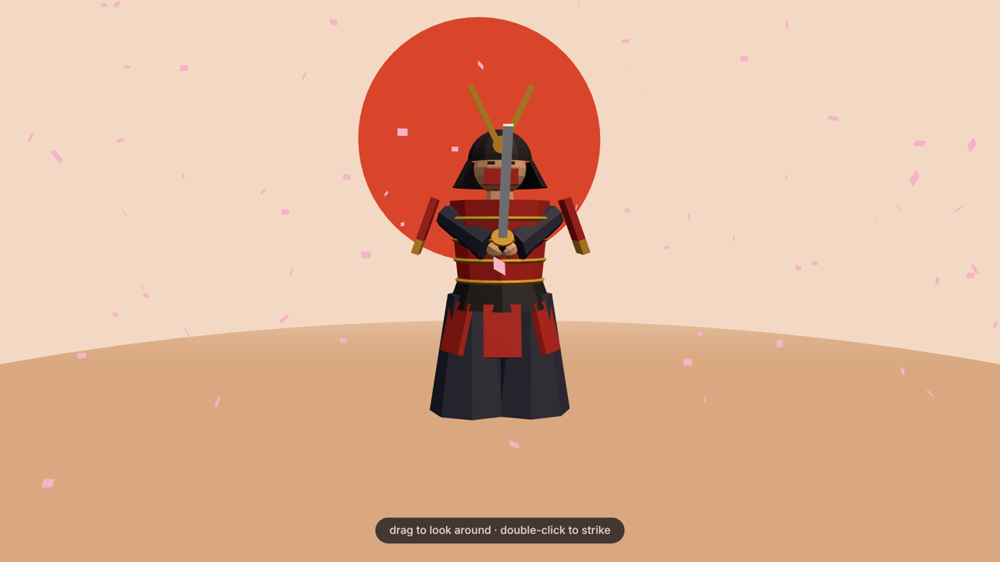

# Three.js Samurai



A low-poly samurai in three.js, built entirely from boxes, cylinders, spheres and a torus. No models and no textures. Sakura petals fall, the camera slowly circles, and a double-click makes him strike.

## How it's built

- **One helper.** `part(geometry, material, x, y, z, parent)` creates a mesh, places it, turns on its shadow and adds it to a group. The whole samurai is calls to `part()`.
- **Hakama.** A cylinder with a narrow top and a wide bottom.
- **Armour.** A red tapered cylinder with gold torus laces, and six skirt plates placed in a ring with `sin` and `cos`.
- **Kabuto helmet.** Half a sphere for the bowl, and an open cylinder for the neck guard. `thetaStart` and `thetaLength` leave a gap so it never covers the face.
- **Crest and shoulder guards.** Rotated boxes, mirrored with `for (const side of [-1, 1])`.
- **Arms and katana** sit in one group, so the strike rotates them together.
- **Low-poly look.** `flatShading: true` on every material.
- **Petals.** One `InstancedMesh` with 160 copies, drawn in a single draw call.
- **The red sun.** A `MeshBasicMaterial` circle with `fog: false`, so the fog never dims it.

## Controls

- **Drag** to orbit, **scroll** to zoom
- **Double-click** to strike

## Run

three.js loads from a CDN through an import map, and browsers won't load ES modules from `file://`. Serve the folder with any static server, for example:

```
npx serve .
```

or the Live Server extension in VS Code, then open the page.

## Files

```
ThreeJS-Samurai/
├── index.html   the import map
├── style.css
├── script.js    the whole scene
└── preview.png
```
